  
  
  <!-- LinkedIn: replace YOUR-PROFILE and uncomment
  
  -->

 

<h2 align="center"> <em>About me</em></h2>

Hi! I'm **Yassir**, an Information Systems Engineering student at Universidad Nacional de Costa Rica (UNA), graduating in 2027.

I like taking code that already works and making it run on many threads, and then measuring honestly whether it was worth it. I also enjoy building things people actually use, from institutional web platforms to tech events for students.

Right now I'm exploring **machine learning** and **quantum computing**.

 

   <b><em>Assistant at UGPCI (UNA): NEXUS UNA platform for the Rector's Office</em></b> 
   <b><em>Vice Chair, IEEE Student Branch UNA</em></b> 
   <b><em>Former teaching assistant: Programming 1 (30 students)</em></b> 
   <b><em>Costa Rica Big Data School 2025 (CeNAT) · Cisco CCNA v7 (3 modules)</em></b>

 

<h2 align="center"> <em>Technologies</em></h2>

  
  
  
  
   
  
  
  
  
  

 

<h2 align="center"> <em>What I work on</em></h2>

> **Parallel Programming** — Parallelizing existing C++ code with OpenMP and checking the results against Amdahl's law, including the cases where thread overhead wins.

> **Systems in C** — Multithreaded servers over TCP sockets, like a Kafka-style message broker with consumer groups and disk persistence.

> **Institutional Software** — Building NEXUS UNA, a web platform that consolidates academic information for UNA's Rector's Office.

> **Tech Community** — Talks, workshops and events with the IEEE Student Branch that connect students with industry.

 

<em>My pinned projects are below ↓</em>

