  
  
  

 

<h2 align="center"> <em>About me</em></h2>

Hi! I'm **Yassir**, an Information Systems Engineering student at Universidad Nacional de Costa Rica (UNA) and an Intermediate Technician in Computer Networks.

I've done a bit of everything: mobile apps, backends, web platforms for my own university and computer networks, and I enjoy picking up whatever a project needs. Outside the code, I spend a lot of my time building community. I helped found the first IEEE Student Branch at UNA, I organize talks and workshops that bring researchers and industry closer to students, and I represent students in university governance.

I'm always up for a new challenge.

 

   <b><em>Assistant at UGPCI (UNA): NEXUS UNA platform for the Rector's Office</em></b> 
   <b><em>Vice Chair, IEEE Student Branch UNA · IEEEXtreme 20 Ambassador</em></b> 
   <b><em>Diploma in Software Application Development (UNA, 2025) · Former TA, Programming 1</em></b> 
   <b><em>Intermediate Technician in Computer Networks · Cisco CCNA v7</em></b> 
   <b><em>Costa Rica Big Data School 2025 (CeNAT)</em></b>

 

<h2 align="center"> <em>Things I've worked with</em></h2>

  
  
  
  
  
   
  
  
  
  
   
  
  
  
  
  

 

<h2 align="center"> <em>Projects</em></h2>

| Project | What it is | Built with |
|---|---|---|
| **Vision-language models for dermatology** · *ongoing research, private* | Independent research collaboration: testing how well general-purpose vision models classify skin images with only a few examples, running on an HPC cluster | Python · deep learning · HPC |
| **Dexter** · *coming soon* | Team app to swap skills between people: Android client, REST API and an AI service that suggests session dates | Kotlin · Spring Boot · PostgreSQL · Gemini · Heroku |
| **NEXUS UNA** · *private* | Web platform that consolidates academic information for UNA's Rector's Office (UGPCI) | Institutional project |
| [MiniKafka](https://github.com/saulfv04/Message-Broker-MiniKafka) | Kafka-style message broker with producers, consumer groups and disk persistence | C · sockets · threads |
| [Parallel browser simulator](https://github.com/yassir2804/proyecto-paralela) | A course project parallelized with OpenMP and measured against Amdahl's law | C++ · OpenMP |
| [Pac-Man](https://github.com/yassir2804/ProyectoDatosPacman) | Pac-Man on a graph-based maze with four ghost behaviours, levels and save/load | Python · Pygame |

 

<h2 align="center"> <em>What I'm curious about</em></h2>

  AI &amp; machine learning · high-performance computing · quantum computing · computer networks · tech communities and education

 
